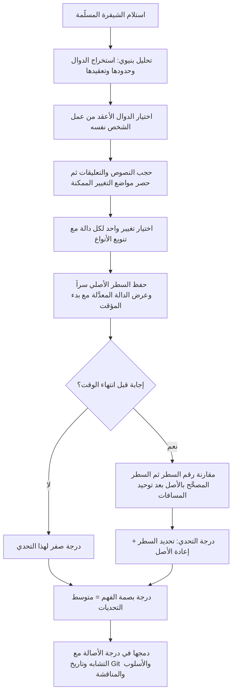

# مسودة طلب براءة اختراع

> **تنبيه مهم:** هذه **مسودة** للتقديم وليست براءة ممنوحة. البراءة تمنحها الجهة الرسمية
> فقط بعد فحص الطلب (في اليمن: الإدارة العامة لحماية الملكية الفكرية، وزارة الصناعة
> والتجارة). اقرأ قسم «قبل التقديم» في آخر الملف.

## 1. عنوان الاختراع

**طريقة ونظام للتحقق من فهم المتقدِّم لشيفرته البرمجية ونسبتها إليه، بزرع تغيير خفي في
شيفرته نفسها وتصحيح اكتشافه آلياً («بصمة الفهم»).**

## 2. المخترع

المهندس / **محمد عبدالرحيم خليل** — الجمهورية اليمنية.

(يُستكمل عند التقديم: العنوان، رقم الهوية، وسيلة الاتصال، وصفة مقدم الطلب.)

## 3. المجال التقني

يتعلق الاختراع بأنظمة تقييم الأعمال البرمجية آلياً، وتحديداً بالتحقق من أن الشخص الذي
سلّم شيفرة برمجية (طالب، متقدم لوظيفة، مقاول برمجيات) يفهمها وهو كاتبها فعلاً.

## 4. الخلفية التقنية (الوضع السابق)

1. **كشف التشابه بين الشيفرات** (مثل MOSS المبني على خوارزمية Winnowing، و JPlag): يقارن
   العمل المسلَّم بأعمال أخرى معروفة. لا يكشف شيفرة اشتُريت أو كُتبت للطالب خصيصاً أو
   وُلّدت بالذكاء الاصطناعي، لأنها لا تشبه عملاً آخر في قاعدة المقارنة.
2. **الاختبار الطفري (Mutation Testing)** (DeMillo و Lipton و Sayward، 1978): يزرع تغييرات
   صغيرة في البرنامج **لقياس جودة حالات الاختبار**، لا لتقييم الشخص.
3. **أسئلة عن شيفرة المتعلم نفسه (Questions about Learners' Code)** (Lehtinen وآخرون،
   2021): تولّد أسئلة نصية عن برنامج الطالب (مثل: ما اسم متغير الحلقة؟) ويجيب عنها
   باختيار أو نص.
4. **المناقشة الشفوية التقليدية**: يعتمد الحكم على خبرة الممتحن ووقته، ويصعب توحيدها على
   مئات الطلاب.

**القصور:** لا توجد، بحسب علم المخترع، وسيلة آلية تختبر معرفة الشخص بمنطق شيفرته بدقة
السطر الواحد، بإجابة تُصحَّح آلياً دون حكم بشري ودون نموذج لغوي، وتُدمج نتيجتها مع بقية
أدلة الأصالة. (يُتحقق من ذلك ببحث الجِدّة الرسمي؛ انظر القسم 10.)

## 5. المشكلة التي يحلها الاختراع

كيف يُتحقق آلياً، وبعدالة، وخلال دقائق، من أن مُسلِّم الشيفرة يعرف منطقها معرفة من
كتبها، حتى حين لا يوجد عمل مشابه يُقارن به؟

## 6. ملخص الاختراع

يأخذ النظام دوالّ من الشيفرة التي سلّمها الشخص نفسه، ويُحدث في كل دالة **تغييراً واحداً
صغيراً** يغيّر منطقها (مثل `and` إلى `or`، أو `+` إلى `-`، أو عكس القيمة المرجعة)، ثم
يعرض الدالة المعدَّلة على الشخص لوقت محدود ويطلب منه: (أ) تحديد السطر الذي تغيّر،
(ب) إعادته كما كان، (ج) شرح أثر التغيير. ولأن النظام يحتفظ بالسطر الأصلي، تُصحَّح (أ)
و(ب) آلياً وبشكل قاطع. كاتب الشيفرة يعرف منطقها فيلاحظ التغيير سريعاً؛ ومن لم يكتبها
يقرؤها أول مرة. تُحسب من ذلك درجة «بصمة الفهم» وتُدمج في درجة أصالة العمل.

## 7. وصف مختصر للرسم

**الشكل 1** — مخطط سير الطريقة:



## 8. الوصف التفصيلي

**8.1 اختيار الدوال.** تُحلَّل الشيفرة بمحللات بنيوية (شجرة الصياغة المجردة) لاستخراج كل
دالة: ملفها، سطر بدايتها ونهايتها، وتعقيدها الدوراني. تُستبعد الدوال القصيرة جداً
(أقل من 6 أسطر) والطويلة جداً (أكثر من 60) وملفات الاختبارات والشيفرة التي لم تُحلَّل.
تُرتَّب الباقية تنازلياً بالتعقيد، مع ترتيب عشوائي بين المتساوية، حتى لا يحصل شخصان
بشيفرة متقاربة على التحدي نفسه.

**8.2 حصر مواضع التغيير.** تُحجب النصوص الحرفية والتعليقات بمسافات بالطول نفسه، ثم يُبحث
في الباقي عن رموز قابلة للاستبدال، كل استبدال يغيّر رمزاً واحداً:

| النوع | أمثلة |
|---|---|
| منطقي | `&&` ↔ `||`، `and` ↔ `or` |
| مساواة | `==` ↔ `!=` |
| حسابي | `+` ↔ `-`، `+=` ↔ `-=` |
| قيمة مرجعة | `return true` ↔ `return false` |
| ثابت | `0` ↔ `1` بعد عامل مقارنة |
| حدّي | `<` ↔ `<=`، `>` ↔ `>=` |

تُشترط مسافات حول العوامل حتى لا تُمسّ الأنواع العامة (`List<T>`) والأسهم (`->`، `=>`).
ولا يُمسّ سطر ترويسة الدالة، ولا عامل الجمع في سطر فيه ضم نصوص. الطريقة مستقلة عن لغة
البرمجة لأنها تعمل على النص بعد الحجب.

**8.3 اختيار التغيير.** يُفضَّل نوع لم يُستخدم في الجلسة، ثم الأنواع التي تغيّر السلوك
غالباً (منطقي، مساواة، حسابي) على الحدّي الذي قد ينتج تغييراً مكافئاً لا يغيّر السلوك.

**8.4 العرض.** لا يُرسل إلى واجهة الشخص إلا نص الدالة المعدَّلة ورقم سطر بدايتها. السطر
الأصلي ووصف التغيير يبقيان في الخادم. يبدأ العدّ (4 دقائق في التطبيق الحالي) لحظة فتح
التحدي لا لحظة إنشائه، ولا يُفتح تحدٍّ قبل إنهاء سابقه.

**8.5 التصحيح.** «حدّد السطر» = تطابق رقم السطر المختار مع سطر التغيير. «أعاد الأصل» =
تطابق السطر المصحَّح مع الأصلي بعد حذف المسافات. الدرجة: 60 للتحديد و40 للإصلاح. تحدٍّ
انتهى وقته = صفر. درجة الجلسة = متوسط التحديات. يُسجَّل الزمن المستغرق وعدد مرات مغادرة
صفحة الاختبار كقرائن للممتحن.

**8.6 الدمج.** تدخل الدرجة عاملاً في درجة الأصالة بجانب تشابه الشيفرة وتاريخ الإيداعات
وثبات الأسلوب وفجوة المناقشة وأصالة التقرير. درجة أقل من 40 ترفع تنبيهاً للممتحن. يُكشف
الأصل للشخص بعد إجابته فقط، وللممتحن دائماً. محاولة واحدة، وللممتحن وحده السماح بإعادة.

**8.7 مثال.** الدالة الأصلية:

```python
def borrow(self, student_id, book_id):
    ...
    if len(active) >= 3 or book.copies <= 0:
        return False
    book.copies -= 1
    self.repository.create_loan(student_id, book_id)
    return True
```

تُعرض وقد صار السطر الأخير `return False`. كاتب الدالة يعرف أن الاستعارة الناجحة تُرجع
`True`، فيحدد السطر ويعيده. النظام يطابق إجابته بالأصل ويمنح الدرجة كاملة.

**8.8 التطبيق.** نُفِّذت الطريقة ضمن نظام «فاحص المشاريع الذكي»: مولّد التغييرات في خدمة
تحليل الشيفرة (`services/code-analyzer/app/challenge/mutations.py`)، وإدارة الجلسة
والتصحيح في خدمة المشاريع (`services/project-service/app/services/fingerprint.py`
و `routes/fingerprint.py`)، والواجهة في `frontend/src/pages/FingerprintPanel.tsx`.

## 9. عناصر الحماية (المطالبات)

1. طريقة منفَّذة بالحاسوب للتحقق من فهم شخص لشيفرة برمجية سلّمها، تتضمن: (أ) استلام
   الشيفرة؛ (ب) تحليلها بنيوياً لتحديد دوالّها؛ (ج) اختيار دالة واحدة على الأقل من تلك
   الشيفرة نفسها؛ (د) إحداث تغيير واحد في رمز واحد من الدالة يغيّر منطقها مع حفظ السطر
   الأصلي؛ (هـ) عرض الدالة المعدَّلة على الشخص دون الإفصاح عن موضع التغيير؛ (و) استلام
   تحديده للسطر وصيغته المصحَّحة؛ (ز) تحديد درجة آلياً بمقارنة الإجابة بالسطر الأصلي
   المحفوظ.
2. الطريقة وفق العنصر 1، حيث تُختار الدوال بترتيب تنازلي لمقياس تعقيد محسوب من الشيفرة.
3. الطريقة وفق العنصر 1، حيث تُحجب النصوص الحرفية والتعليقات قبل تحديد مواضع التغيير،
   فتكون الطريقة مستقلة عن لغة البرمجة.
4. الطريقة وفق العنصر 1، حيث يُختار التغيير من أصناف (منطقي، مساواة، حسابي، قيمة مرجعة،
   ثابت، حدّي) مع تفضيل الأصناف التي يُرجَّح أن تغيّر السلوك وتنويعها داخل الجلسة.
5. الطريقة وفق العنصر 1، حيث يُحدَّد وقت للإجابة يبدأ عند عرض الدالة، وتُمنح درجة صفر
   عند انقضائه دون إجابة.
6. الطريقة وفق العنصر 1، حيث تتكون الدرجة من جزء لتحديد السطر وجزء لإعادة الأصل، وتُعدّ
   الصيغة صحيحة إذا طابقت الأصل بعد توحيد المسافات.
7. الطريقة وفق العنصر 1، حيث تُدمج الدرجة مع مؤشر واحد على الأقل من: تشابه الشيفرة مع
   أعمال أخرى، تاريخ الإيداعات، ثبات أسلوب الكتابة، نتيجة مناقشة، لحساب درجة أصالة.
8. الطريقة وفق العنصر 1، حيث يُسجَّل الزمن المستغرق وعدد مرات مغادرة واجهة الاختبار ويُعرضان
   على الممتحن.
9. نظام يتضمن معالجاً وذاكرة مخزَّنة فيها تعليمات تنفّذ الطريقة وفق أي من العناصر 1–8،
   ويتضمن خدمة تولّد التغيير، وخدمة تحفظ الأصل وتصحّح، وواجهة تعرض الدالة المعدَّلة.
10. وسط تخزين غير عابر مقروء بالحاسوب يحمل تعليمات تنفّذ الطريقة وفق أي من العناصر 1–8.

## 10. الملخص

طريقة ونظام للتحقق من أن مُسلِّم شيفرة برمجية يفهمها. تُحلَّل الشيفرة لاستخراج دوالّها،
وتُختار الأعقد، ويُحدَث في كل منها تغيير واحد صغير يغيّر منطقها مع حفظ الأصل سراً. تُعرض
الدالة المعدَّلة لوقت محدود، ويحدد الشخص السطر المتغيّر ويعيده كما كان. تُصحَّح الإجابة
آلياً بمقارنتها بالأصل، وتُحسب درجة «بصمة الفهم» وتُدمج مع مؤشرات أخرى في درجة أصالة
العمل.

## 11. حدود معروفة (تُذكر بأمانة)

- من يملك نسخة من الملفات يستطيع نظرياً مقارنتها نصياً؛ يُحدّ من ذلك بالوقت القصير،
  وتسجيل مغادرة الصفحة، وإجراء الاختبار أمام الممتحن. والاختبار قرينة لا حكم.
- التغيير الحدّي قد يكون مكافئاً لا يغيّر السلوك؛ لذا يُؤخَّر في الأولوية، ويبقى اكتشافه
  ممكناً لمن يعرف نصّ شيفرته.
- المشاريع التي لا دالة فيها بين 6 و60 سطراً لا يُولَّد لها تحدٍّ.

## 12. قبل التقديم

1. **الإفصاح العلني يهدم شرط الجِدّة.** نشر الفكرة أو الشيفرة علناً (مستودع GitHub عام،
   عرض، بحث منشور) قبل إيداع الطلب قد يُسقط الحق في البراءة. اجعل المستودع خاصاً، أو
   أودِع الطلب أولاً.
2. **بحث الجِدّة.** ابحث في Google Patents و WIPO PATENTSCOPE و Espacenet بعبارات مثل:
   *mutation code authorship verification*، *seeded defect student own code assessment*،
   *program comprehension verification mutation*. إن وُجد ما يطابق العنصر 1 فضيّق
   المطالبات على ما بقي جديداً.
3. **البرمجيات والبراءة.** قوانين كثيرة تستثني «برامج الحاسوب في حد ذاتها»؛ لذلك صيغت
   المطالبات كطريقة ونظام لهما أثر تقني. اسأل الجهة المختصة أو وكيل براءات معتمداً عن
   القبول في اليمن، وعن بديل **تسجيل حق المؤلف** للبرنامج، وهو أسهل ويحمي الشيفرة نفسها.
4. **المخترع ومقدم الطلب.** إن أُنجز العمل ضمن مشروع تخرج، راجع لائحة الجامعة في ملكية
   مخرجات المشاريع قبل التقديم.

*هذه المسودة ليست استشارة قانونية.*
